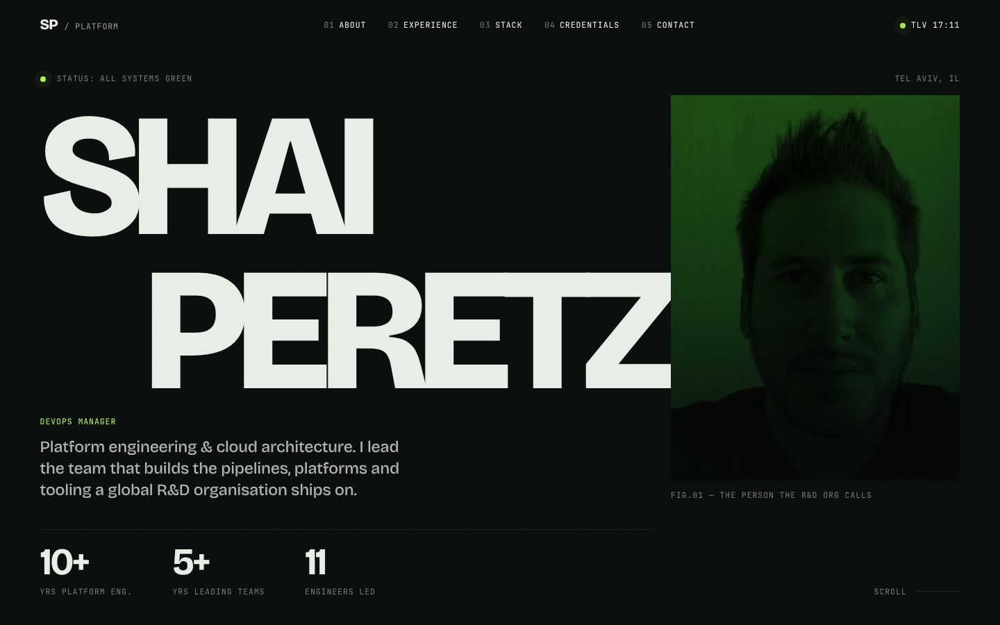

<div align="center">

# Shai Peretz · Personal Site

**The personal website of Shai Peretz, DevOps Manager.**
Platform engineering, CI/CD and cloud architecture, told as an interactive one-page story.

[](https://github.com/shaiperets/sp/actions/workflows/ci.yml)
[](https://github.com/shaiperets/sp/actions/workflows/codeql.yml)
[](https://github.com/shaiperets/sp/actions/workflows/pages.yml)
[](LICENSE)

</div>



## Contents

- [About](#about)
- [Features](#features)
- [Tech stack](#tech-stack)
- [Getting started](#getting-started)
- [Project structure](#project-structure)
- [Quality gates](#quality-gates)
- [Deployment](#deployment)
- [Development workflow](#development-workflow)
- [Security](#security)
- [License](#license)

## About

This repository holds the source of a single-page personal site. It presents ten-plus years of platform engineering and five-plus years of leading DevOps teams, with experience laid out as a `git log`, an interactive skills constellation and a terminal you can type into.

It is a plain static site: no framework, no bundler and no runtime build step. The repository itself is run like a production service, with protected `main`, required CI, code scanning and automated dependency updates.

## Features

- **Kinetic hero** with a canvas background and a preloader styled as a boot log
- **Experience timeline** presented as a scroll-driven `git log`
- **Skills constellation**: a filterable canvas graph, with a screen-reader list as fallback
- **Interactive terminal** in the contact section
- **Smooth scrolling** (Lenis) and scroll-linked motion (GSAP ScrollTrigger)
- **Accessible by default**: semantic landmarks, `prefers-reduced-motion` support, and decorative layers hidden from assistive tech

## Tech stack

| Layer | Choice |
| --- | --- |
| Markup and styles | HTML5, modern CSS (custom properties, `clamp()` fluid type) |
| Behavior | Vanilla JavaScript (ES2022), no framework |
| Motion | [GSAP 3](https://gsap.com/) with ScrollTrigger, [Lenis](https://lenis.darkroom.engineering/) |
| Fonts | Bricolage Grotesque and JetBrains Mono (Google Fonts) |
| Tooling | HTMLHint, Stylelint, ESLint, lychee, Lighthouse CI, CodeQL |
| Hosting | GitHub Pages, deployed by GitHub Actions |

Third-party libraries load from cdnjs and jsDelivr with pinned versions.

## Getting started

**Requirements:** a modern browser. Node.js 20+ is only needed for the linters.

```bash
git clone https://github.com/shaiperets/sp.git
cd sp

# Option 1: Node
npm ci
npm start              # http://localhost:8080

# Option 2: no Node needed
python3 -m http.server 8080
```

Opening `index.html` straight from disk also works, but a local server matches production more closely.

### Available scripts

| Command | What it does |
| --- | --- |
| `npm start` | Serve the site locally on port 8080 |
| `npm run lint` | Run all linters (HTML, CSS, JS) |
| `npm run lint:html` | HTMLHint on `index.html` |
| `npm run lint:css` | Stylelint on `css/` |
| `npm run lint:js` | ESLint on `js/` |
| `./scripts/build-site.sh` | Assemble the deployable site into `_site/` |

## Project structure

```text
.
├── index.html              # The whole page: markup and content
├── css/
│   └── style.css           # Design tokens, layout and motion styles
├── js/
│   ├── main.js             # Boot, preloader, hero canvas, Lenis and GSAP scenes
│   ├── viz.js              # Generated SVG illustration for each role
│   ├── constellation.js    # Interactive skills graph
│   └── terminal.js         # Contact-section terminal
├── assets/                 # Photos, reel video and poster (metadata stripped)
├── docs/                   # README media
├── scripts/
│   └── build-site.sh       # Copies only public files into _site/
├── .claude/skills/         # Design skills used for UI work (awwwards, ui-ux-pro-max)
├── .github/
│   ├── workflows/          # CI, CodeQL and Pages deploy
│   ├── ISSUE_TEMPLATE/     # Bug and improvement forms
│   ├── CODEOWNERS
│   ├── dependabot.yml
│   └── pull_request_template.md
└── lighthouserc.json       # Lighthouse budgets
```

## Quality gates

Every pull request to `main` must pass these checks before it can merge:

| Check | Tool | Fails when |
| --- | --- | --- |
| Lint | HTMLHint, Stylelint, ESLint | Invalid markup, CSS errors, JS errors |
| Link check | [lychee](https://github.com/lycheeverse/lychee) | A link in the HTML or docs is broken |
| Lighthouse | [Lighthouse CI](https://github.com/GoogleChrome/lighthouse-ci) | Accessibility score drops below 90 (performance, SEO and best practices warn) |
| Dependency review | GitHub | A new dependency has a high-severity vulnerability |
| Code scanning | CodeQL | A security issue is found in JS, Python or workflows |

Lighthouse reports are attached to each workflow run as artifacts.

## Deployment

Pushing to `main` deploys automatically through [`.github/workflows/pages.yml`](.github/workflows/pages.yml):

1. `scripts/build-site.sh` copies only `index.html`, `css/`, `js/` and `assets/` into `_site/`, so tooling, docs and skills are never published.
2. The artifact is uploaded and deployed to GitHub Pages in the `github-pages` environment.

One-time setup: **Settings → Pages → Build and deployment → Source: GitHub Actions**. The site is then served at `https://shaiperets.github.io/sp/`, or on a custom domain if one is configured.

## Development workflow

`main` is protected, so all work happens on branches and lands through pull requests.

```text
branch from main → commit (Conventional Commits) → open PR → CI green → review → squash merge → auto-deploy
```

- Branch names: `feat/…`, `fix/…`, `content/…`, `ci/…`, `docs/…`
- Commits and PR titles follow [Conventional Commits](https://www.conventionalcommits.org/)
- Merged branches are deleted automatically
- Dependabot opens grouped update PRs every Monday for npm and GitHub Actions

See [CONTRIBUTING.md](CONTRIBUTING.md) for the full guide and [CODE_OF_CONDUCT.md](CODE_OF_CONDUCT.md) for community standards.

## Security

Please report vulnerabilities privately as described in [SECURITY.md](SECURITY.md). Do not open public issues for security problems.

The repository uses CodeQL, secret scanning with push protection, Dependabot alerts, dependency review, and SHA-pinned GitHub Actions with least-privilege tokens.

## License

The source code is licensed under the [Apache License 2.0](LICENSE).

The personal content (photos, video, biography and career text) is © Shai Peretz, all rights reserved, and is not covered by the code license. Please don't reuse it without permission.

Vendored third-party material keeps its own license, for example [`.claude/skills/ui-ux-pro-max/LICENSE`](.claude/skills/ui-ux-pro-max/LICENSE) (MIT).
